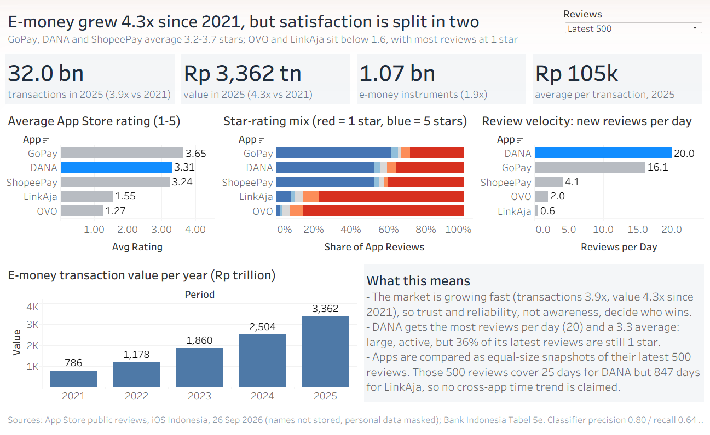
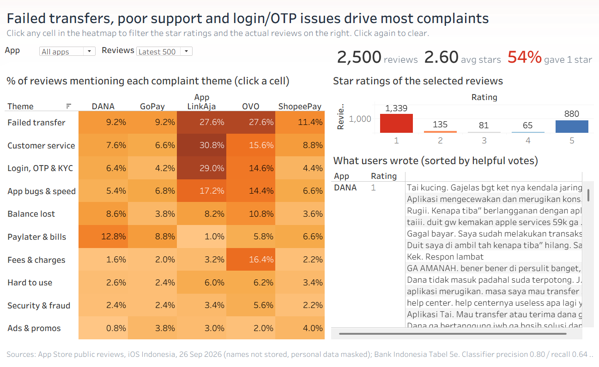
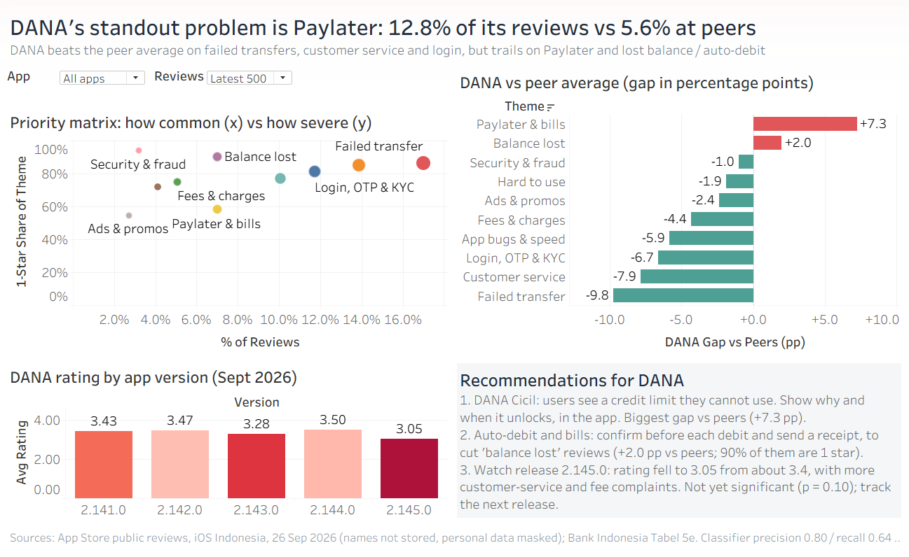

# E-Wallet Voice of Customer: What Indonesian Users Complain About

An end-to-end analytics project on Indonesia's five main e-wallets (DANA, GoPay, OVO, ShopeePay, LinkAja).
It combines two scraped public sources:

- **Apple App Store reviews:** 3,157 unique reviews, from the latest 500 and the 500 most-helpful reviews per app.
- **Bank Indonesia e-money statistics:** a table read from a PDF that the scraper finds on bi.go.id.

It then answers three questions:

1. How big is the market, and how satisfied are users with each app?
2. Which problems drive the complaints, and in which app?
3. What should DANA fix first, compared with its peers?

**Interactive Tableau dashboards:** 3 views. Filter by app and by review type (latest vs most helpful). Click any cell of the complaint heatmap to read the reviews behind it.





## Key findings

- **Market:** in 2021–2025, e-money transactions grew 3.9x to 32.0 billion and value grew 4.3x to Rp 3,362 trillion (Bank Indonesia).
- **Satisfaction splits in two:**

  | App | Average stars | Latest reviews at 1 star |
  |---|---|---|
  | GoPay | 3.65 | — |
  | DANA | 3.31 | — |
  | ShopeePay | 3.24 | — |
  | LinkAja | 1.55 | 77% |
  | OVO | 1.27 | 86% |

- **Top complaint themes across the market** (share of reviews, each app weighted equally):

  | Theme | Share of reviews | Of those, 1-star |
  |---|---|---|
  | Failed / pending transfers | 17% | 86% |
  | Customer service | 14% | — |
  | Login / OTP / KYC | 12% | — |

- **DANA vs peers:**
  - DANA does better than the peer average on failed transfers (−9.8 pp), customer service (−7.9 pp) and login (−6.7 pp).
  - DANA does worse on **Paylater / DANA Cicil**: 12.8% of its reviews vs 5.6% at peers (+7.3 pp). Most of these users see a credit limit they cannot use.
  - DANA also does worse on **balance lost / auto-debit** (+2.0 pp). This theme is the most severe: 90% of these reviews are 1 star.
- **Release watch:** DANA 2.145.0 averages 3.05 stars, against about 3.4 for the four earlier September releases. This is not yet statistically significant (chi-square p = 0.10).

## Pipeline

| Step | Script | What it does |
|---|---|---|
| 1 | `fetch_reviews.py` | Reads Apple's official review feed (10 pages × 50 reviews, two sort orders per app). Caches raw pages, retries on timeouts, never stores reviewer names, masks phone numbers, e-mails, long digit strings and @handles. |
| 2 | `scrape_bi_emoney.py` | Scrapes the Bank Indonesia payment-statistics page and finds the "Tabel 5e" download links. See the notes below. |
| 3 | `classify.py` | Tags each review with 10 complaint themes, using transparent regex rules for Indonesian slang. One review can have several themes. |
| 4 | `validate.py` | Compares the rules with 100 hand-labelled reviews that were not used to write the rules, and reports precision and recall per theme. |
| 5 | `analysis.py` | Builds the scorecard, review velocity, priority matrix (frequency × severity), DANA-vs-peers gaps, the version check (chi-square) and the most-helpful lens. |
| 6 | `build_dashboard_data.py` | Writes the two tidy CSVs that Tableau reads. |
| 7 | `build_workbook.py` | Generates the Tableau workbook (`.twb`) as code: every calculation, colour, filter, dashboard action and layout. |

`scrape_bi_emoney.py` in more detail:

- It checks the file's magic bytes. The Excel link returned an HTML 404 page, so the script falls back to the PDF.
- It parses the PDF across two page layouts with pdfplumber.
- It checks that the December stock equals the annual figure.

The scrapers use polite settings: an honest User-Agent, delays between requests, a cache, and a stop on HTTP 403/429/503.

```bash
pip install -r requirements.txt
python fetch_reviews.py && python scrape_bi_emoney.py
python classify.py && python validate.py && python analysis.py
python build_dashboard_data.py && python build_workbook.py
```

## Method notes and limits

- **Equal-size snapshots, not time trends.** The latest 500 reviews cover 25 days for DANA but 847 days for LinkAja. Apps are therefore compared on shares of equal-size snapshots. Review velocity (reviews per day) is shown separately, and no cross-app trend over time is claimed.
- **Classifier accuracy is reported honestly:**

  | Test | Precision | Recall |
  |---|---|---|
  | Held-out sample, before tuning | 0.80 | 0.64 |
  | Same sample, after tuning the rules (optimistic, because the sample was then seen) | 0.83 | 0.83 |

  See `validation_results_*.csv`.
- **Sample coverage:**
  - The data covers iOS only. Android users, who are the majority in Indonesia, may differ.
  - People who write reviews skew towards strong opinions.
- **Theme names are short labels.** "Paylater & bills" also catches bill-payment and subscription debits.
- **Independence:** this is an independent analysis of public data. It is not affiliated with any of the companies.
